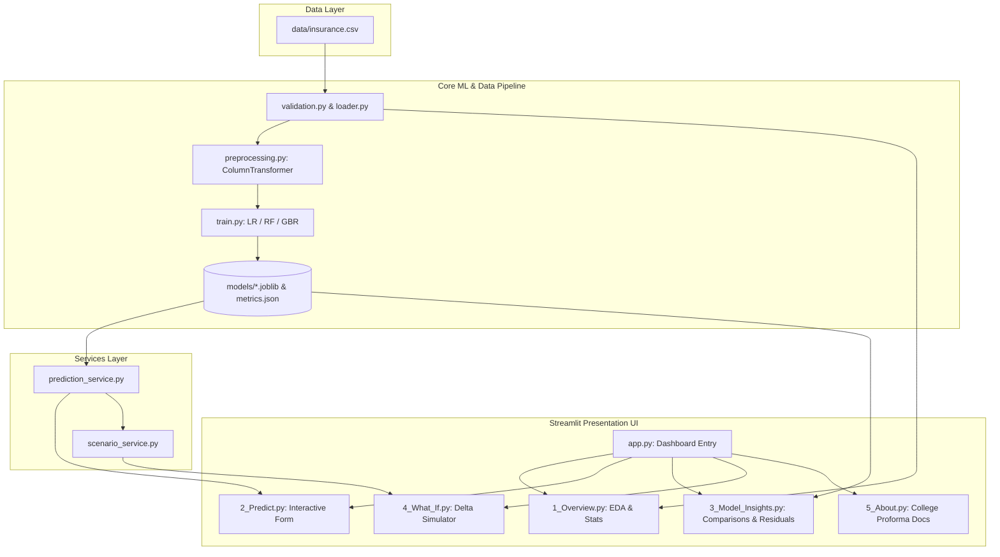

# Implementation Plan: Pure Python Medical Insurance Cost Prediction Dashboard

## Goal Description
Build a comprehensive, cross-platform academic machine-learning web application and analytics dashboard for the college project titled **"Medical Insurance Cost Prediction Using Machine Learning"** (BE IV Year E&TC, DAVV, Session 2026-27, Group No. 11).

The deliverable is a **100% pure Python stack**: an interactive Streamlit UI, reproducible scikit-learn training & evaluation pipelines, exploratory data analysis with Plotly, a hypothetical what-if scenario engine, backed by rigorous unit/integration tests and complete academic documentation.

---

## Technical Architecture



---

## Project Layout (100% Pure Python)

```
college-proj/two/
├── app.py                      # Main entrypoint
├── pages/
│   ├── 1_Overview.py           # EDA & Data Quality Audit
│   ├── 2_Predict.py            # Interactive Single Profile Form
│   ├── 3_Model_Insights.py     # Multi-Model Benchmark & Residuals
│   ├── 4_What_If.py            # What-If Scenario Simulator
│   └── 5_About.py              # Academic Proforma & Documentation
├── src/
│   └── insurance_app/
│       ├── __init__.py
│       ├── config.py           # Cross-platform pathlib configurations
│       ├── data/
│       │   ├── __init__.py
│       │   ├── loader.py       # Dataset loader with caching
│       │   └── validation.py   # Complete dataset auditor
│       ├── features/
│       │   ├── __init__.py
│       │   └── schema.py       # Shared schema contract & dataclasses
│       ├── ml/
│       │   ├── __init__.py
│       │   ├── preprocessing.py # ColumnTransformer factory
│       │   ├── train.py        # Pipeline training engine
│       │   ├── evaluate.py     # Metrics (MAE, RMSE, R²) & residuals
│       │   └── registry.py     # Model loading & caching
│       ├── analytics/
│       │   ├── __init__.py
│       │   ├── statistics.py   # Summary statistics & correlation
│       │   └── charts.py       # Plotly chart builders
│       ├── services/
│       │   ├── __init__.py
│       │   ├── prediction_service.py # Authoritative predictor
│       │   └── scenario_service.py   # What-if delta calculator
│       └── ui/
│           ├── __init__.py
│           ├── components.py   # Reusable UI cards & banners
│           └── styling.py      # CSS styles
├── data/
│   └── insurance.csv           # 1,338 records
├── models/                     # Saved joblib pipelines & metrics
│   ├── linear_regression.joblib
│   ├── random_forest.joblib
│   ├── gradient_boosting.joblib
│   ├── metrics.json
│   ├── metadata.json
│   └── evaluation_cache.json
├── scripts/
│   ├── train_models.py         # Standalone training CLI
│   └── check_environment.py    # Environment diagnostic script
├── tests/
│   ├── conftest.py
│   ├── test_schema.py
│   ├── test_data_validation.py
│   ├── test_preprocessing.py
│   ├── test_metrics.py
│   ├── test_prediction.py
│   └── test_scenarios.py
├── docs/                       # Complete academic deliverables
│   ├── PROJECT_REPORT.md
│   ├── VIVA_QUESTIONS.md
│   ├── ARCHITECTURE.md
│   ├── DATASET.md
│   ├── ML_METHODOLOGY.md
│   ├── USER_GUIDE.md
│   └── TESTING.md
├── planning/
│   ├── python_implementation_guidelines.md
│   ├── implementation_plan.md
│   └── checklist.md
├── requirements.txt
├── pyproject.toml
└── README.md
```
