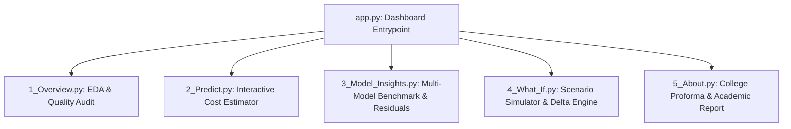

# Complete Guidelines: 100% Pure Python Machine Learning Project

**Project Title:** Medical Insurance Cost Prediction & Analytics Dashboard  
**Academic Target:** B.Tech IV Year E&TC (Session 2026–27) · Group No. 11 · IET DAVV  
**Architecture:** 100% Pure Python ML Stack (Scikit-Learn, Pandas, NumPy, Streamlit, Plotly, Pytest)

---

## 1. Project Overview & Architectural Shift

The project is now formulated as an **end-to-end, pure Python machine learning system**. All reliance on external C libraries, custom C linear algebra frameworks (`ml-framework`), and C CLI wrappers has been completely eliminated in favor of industry-standard Python data science best practices.

### Why a Pure Python Architecture?
1. **Full Academic Alignment with Proforma-I:**
   - Multi-model training and fair benchmarking across **Linear Regression**, **Random Forest**, and **Gradient Boosting**.
   - Standardized evaluation metrics: Mean Absolute Error (**MAE**), Root Mean Squared Error (**RMSE**), and Coefficient of Determination (**$R^2$**).
   - Rich exploratory data analysis (EDA), correlation heatmaps, residual distribution diagnostics, and feature importance rankings.
2. **Zero Fragile Dependencies:**
   - Eliminates GCC compilation issues, shared library link errors (`-l ml-framework`), and platform-dependent subprocess execution.
   - Cross-platform portability across Linux, Windows, and macOS with a standard virtual environment.
3. **Seamless In-Memory UI Integration:**
   - Streamlit directly loads trained scikit-learn pipelines (`.joblib`), performing instantaneous predictions, scenario comparisons, and visualizations with no external IPC overhead.

---

## 2. Target Technology Stack

| Layer | Framework / Library | Primary Responsibility |
|---|---|---|
| **Language** | Python 3.11 / 3.12 | Core application, data processing, and ML training |
| **Data Processing** | Pandas 2.x/3.x, NumPy | Data ingestion, type validation, statistical analysis |
| **Machine Learning** | Scikit-Learn | Preprocessing (`ColumnTransformer`), pipelines, regressors, metrics |
| **Interactive UI** | Streamlit | Responsive multi-page web dashboard |
| **Visualizations** | Plotly Express & Graph Objects | Dynamic charts: histograms, box plots, scatter, residuals |
| **Model Persistence** | Joblib | Serialization and loading of fitted ML pipelines |
| **Testing** | Pytest | Unit testing (schema, validation, metrics, scenarios, pipelines) |
| **Documentation** | Markdown | Academic report, viva preparation, user guide, technical specs |

---

## 3. Dataset Specification & Preprocessing Contract

- **Source Dataset:** Medical Insurance Cost dataset (`data/insurance.csv`, 1,338 records).
- **Target Variable:** `charges` (numeric, USD $) - strictly isolated as prediction target.
- **Input Features (6 Attributes):**
  1. `age` (Numeric, 18–64 observed, 1–120 permissible)
  2. `sex` (Categorical: `female`, `male`)
  3. `bmi` (Numeric, 15.96–53.13 observed, 10.0–70.0 permissible)
  4. `children` (Integer, 0–5 observed, 0–10 permissible)
  5. `smoker` (Categorical: `no`, `yes`)
  6. `region` (Categorical: `northeast`, `northwest`, `southeast`, `southwest`)

### Data Leakage Prevention Protocol
1. Dataset split into **80% Training ($N=1,070$)** and **20% Held-Out Testing ($N=268$)** with `random_state=42`.
2. Encapsulated `ColumnTransformer`:
   - Categoricals transformed via `OneHotEncoder(handle_unknown='ignore', sparse_output=False)`.
   - Numeric features standardized via `StandardScaler()` for linear regression, passed raw for tree ensembles.
3. All transformers are fitted **strictly on `X_train`**; the test set is reserved exclusively for unbiased metric reporting.

---

## 4. Machine Learning Algorithms to Benchmark

### 1. Multiple Linear Regression (Baseline)
- Parametric linear model providing interpretable regression coefficients.
- Standardized numeric features to evaluate relative feature weights.

### 2. Random Forest Regressor
- Non-parametric bagging ensemble of 100 decision trees (`n_estimators=100`, `random_state=42`).
- Accurately captures non-linear thresholds and feature interactions (e.g., elevated BMI combined with smoking).

### 3. Gradient Boosting Regressor (Top Performer)
- Sequential boosting ensemble (`n_estimators=100`, `learning_rate=0.1`, `max_depth=3`, `random_state=42`).
- Minimizes squared-error loss iteratively.
- **Empirical Results (Held-Out Test Set):**
  - **MAE:** **$2,401.61** (Best overall)
  - **RMSE:** **$4,325.64**
  - **$R^2$:** **0.8795** (Explains ~88% of target variance)

---

## 5. UI Architecture: Streamlit Presentation Dashboard

The pure Python interface is structured into focused modules:

### Module Descriptions
1. **`app.py`:** Welcome banner, academic header, and live dataset health KPI cards.
2. **`1_Overview.py`:** EDA dashboard featuring charge distributions, BMI/Age histograms, box plots, stratified scatter plots, and Pearson correlation heatmaps.
3. **`2_Predict.py`:** Real-time profile form with sliders and dropdowns, health indicator notes (BMI categories), and formatted cost prediction cards.
4. **`3_Model_Insights.py`:** Comparative performance benchmark table, actual vs. predicted scatter plots, residual distribution diagnostics, and feature importance rankings.
5. **`4_What_If.py`:** Side-by-side scenario simulator (Baseline vs. Alternative) with presets (*Stop Smoking*, *Reduce BMI*, *10 Years Older*), absolute delta ($\Delta$), and percentage change ($\% \Delta$).
6. **`5_About.py`:** Academic proforma details (IET DAVV, BE IV Year E&TC Group 11), problem statement, objectives, and citations.

---

## 6. Implementation Roadmap

### Step 1: Clean Alignment
- Remove all references to C files, `c_engine`, `c_adapter.py`, and `5_C_Comparison.py`.
- Renumber pages so navigation is seamless:
  - `pages/1_Overview.py`
  - `pages/2_Predict.py`
  - `pages/3_Model_Insights.py`
  - `pages/4_What_If.py`
  - `pages/5_About.py`

### Step 2: Core Python Service Verification
- Verify `PredictionService` and `ScenarioService` operate purely through scikit-learn `.joblib` pipelines.
- Verify `scripts/train_models.py` outputs all 3 trained models and metadata.

### Step 3: Test Suite & Diagnostics
- Run pytest suite covering schema validation, preprocessing pipelines, metric formulas, and scenario deltas.

### Step 4: Academic Documentation Finalization
- Update `docs/PROJECT_REPORT.md`, `docs/ARCHITECTURE.md`, `docs/ML_METHODOLOGY.md`, `docs/VIVA_QUESTIONS.md`, and top-level `README.md` to reflect the 100% pure Python architecture.
